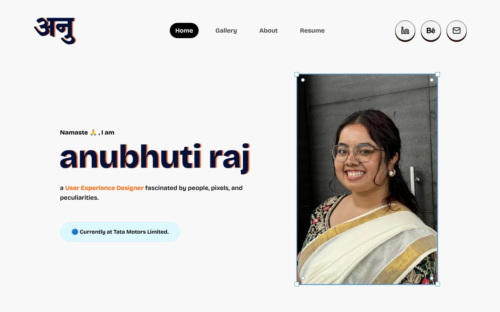
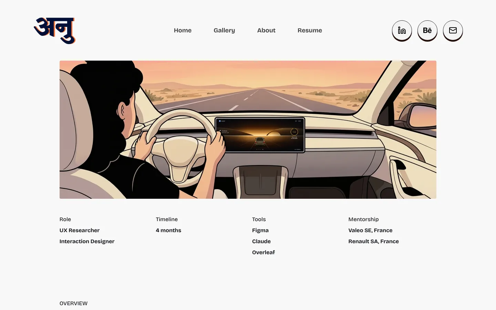
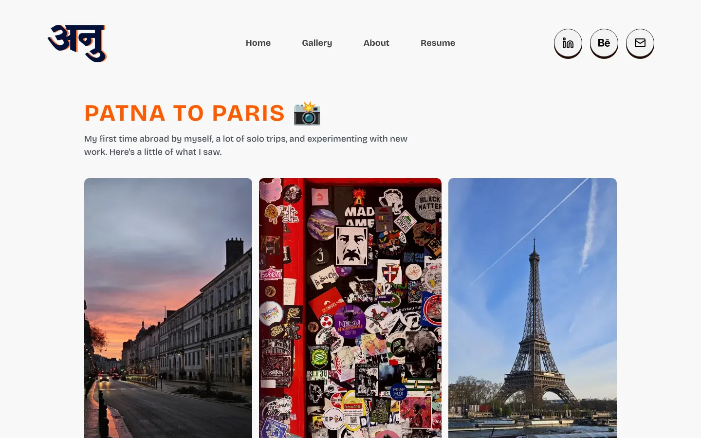
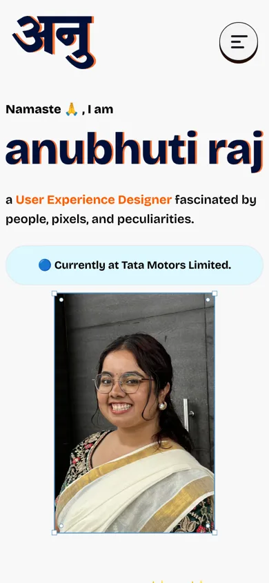

<div align="center">

# अनु · Anubhuti Raj

**A UX designer fascinated by people, pixels, and peculiarities.**

[**Visit the portfolio →**](https://rajanubhuti.github.io/portfolio/)

[LinkedIn](https://www.linkedin.com/in/anubhutiraj-ux) · [Behance](https://www.behance.net/anubhutiraj) · [Email](mailto:anubhutiraj.ux@gmail.com) · [Resume](https://rajanubhuti.github.io/portfolio/assets/docs/anubhuti-raj-resume.pdf)

<br>



</div>

---

## Hi :)

This is the code for my personal portfolio. I wanted it to feel less like a résumé and more like a diary: something that walks you through how I think, with a few small surprises along the way.

I'm a final-year UX student at MIT Institute of Design, Pune, currently a UX design intern at Tata Motors. I spent a semester in France at ESAD Orléans, and most of my work sits somewhere between research, interaction design and cars.

## What's inside

### My work

| Case study | What it's about |
|---|---|
| [**Designing the Return**](https://rajanubhuti.github.io/portfolio/my-work/project-1/) | An in-car display for the sixty seconds before a Level 3 car hands control back to its driver. Grounded in takeover research, mentored by engineers at Valeo and Renault. |
| [**Tata Motors Ticketing Assistant**](https://rajanubhuti.github.io/portfolio/my-work/project-2/) | Turning an internal ticketing form into an assistant that helps people find an answer before they need to raise a ticket. Includes a design system and a WCAG contrast audit. |
| [**LumiTrack**](https://rajanubhuti.github.io/portfolio/my-work/project-3/) | A teaching dashboard that gives design faculty their time back, so mentoring is about the student, not the spreadsheet. |



### Gallery: Patna to Paris 📸

My first time abroad by myself. Solo trips, street posters, cathedrals, and a lot of new things tried for the first time.



### About

Where I grew up, where I've been, how I work, and what I'm good at.

## Little things I hid in here

Some details I had a lot of fun making. Go find them!

- **Then and now.** Hover over my photo on the homepage (or tap it on your phone) and it flips to a photo of me as a kid.
- **A Figma frame.** My photo sits inside a selection box, like it's still on my canvas.
- **"Since July 2026 :)"** Tap the *Currently at Tata Motors* pill and a little note pops out.
- **Sparkles and doodles** that twinkle and replay when you hover or tap them.
- **A camera that flashes** on the gallery page.
- **A gallery that lays itself out.** Photos are arranged in rows of equal height, each keeping its own shape, and only load when you scroll near them.
- **A nav that comes back.** Scroll down and it gets out of your way; scroll up even a little and it's there again.
- **Calm mode.** If your device is set to reduce motion, all the animations switch off.



## How it's built

- Plain **HTML, CSS and JavaScript**. No framework and no build step.
- Shared pieces (header, footer, menu, project cards) live in `partials/` and are added to each page with small scripts, so I only edit them in one place.
- Set in **Bricolage Grotesque**.
- Gallery photos are saved as **WebP** in small, medium and large sizes, so phones don't download huge files.
- Works on phones, with its own menu and layout.
- Hosted for free on **GitHub Pages**.

## Folder map

```
portfolio/
├── index.html          homepage
├── about/              about page
├── play/               photo gallery (Patna to Paris)
├── my-work/
│   ├── project-1/      Designing the Return
│   ├── project-2/      Tata Motors Ticketing Assistant
│   ├── project-3/      LumiTrack
│   └── *-v1, *-v2      earlier and alternate versions of case studies
├── partials/           shared header, footer, menu, cards and animations
├── css/                main stylesheet
└── assets/
    ├── images/         photos and card backgrounds
    ├── fonts/          Bricolage Grotesque
    ├── docs/           resume and research paper (PDF)
    └── readme/         screenshots for this README
```

## Run it on your computer

No installs needed. Clone it and start any simple local server:

```bash
git clone https://github.com/rajanubhuti/portfolio.git
cd portfolio
python3 -m http.server 8000
```

Then open [localhost:8000](http://localhost:8000).

## Please don't copy

You're welcome to look around the code and learn from it. But the case studies, writing, photos and illustrations are mine, so please don't reuse them or pass them off as your own.

---

<div align="center">

Thanks for visiting! Let's tinker together ✨

**[anubhutiraj.ux@gmail.com](mailto:anubhutiraj.ux@gmail.com)**

</div>
